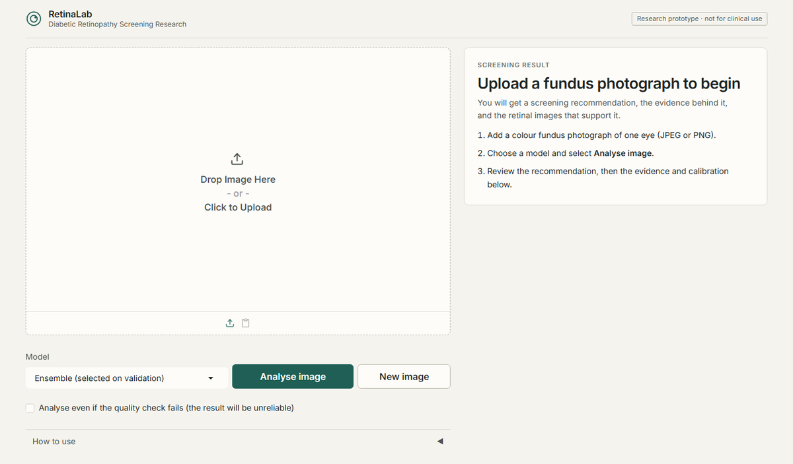
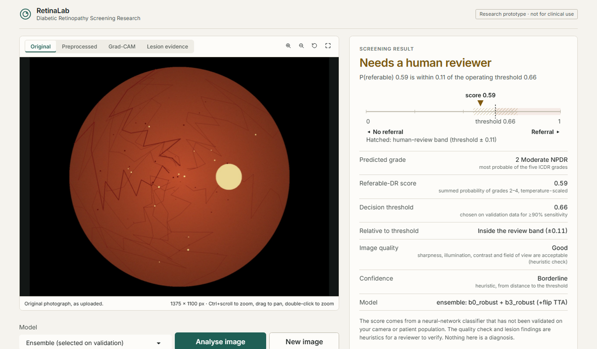
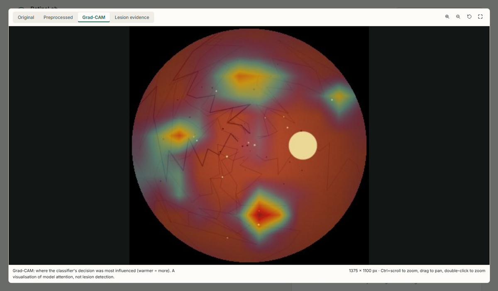
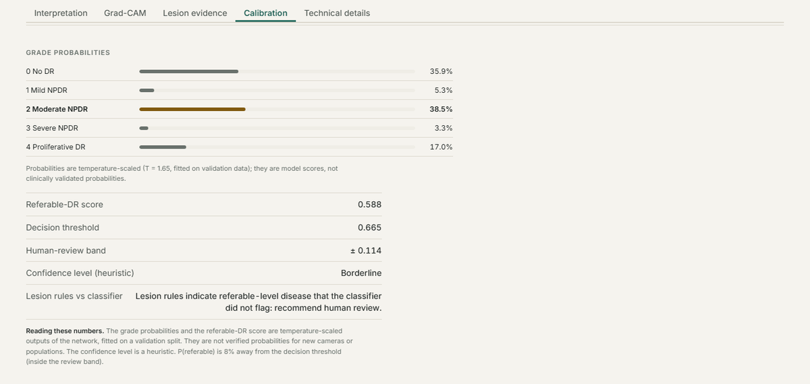

# Diabetic Retinopathy Screening — Research Prototype

> This project is an academic research prototype for diabetic retinopathy screening. Its outputs are not a medical diagnosis and must not be used as a substitute for qualified clinical assessment.

Five-grade ICDR classification and referable-DR screening (grade ≥ 2) from colour fundus photographs. An ImageNet-pretrained EfficientNet (B0 and B3 ensemble with flip test-time augmentation) is fine-tuned on APTOS 2019, calibrated with temperature scaling, and operated at a threshold chosen on validation data. Around the classifier: a heuristic image-quality gate, Grad-CAM, an IDRiD-trained lesion segmenter with an ICDR rule engine that states its reasons, and **RetinaLab**, a Gradio interface that produces a PDF case report.

## Demo

Screenshots use the project's synthetic test fundus (procedurally generated, not a patient image), so the prediction shown is not meaningful; real dataset images are not redistributed here.

**1. Upload** a colour fundus photograph, pick a model and press *Analyse image*.



**2. Read the result.** The recommendation (refer, no referral, human review or retake) sits beside the image, with the score plotted against the decision threshold and its review band.



**3. Inspect the image.** Switch between original, preprocessed, Grad-CAM and lesion views; zoom, pan or expand.



**4. Check the evidence.** Tabs below explain the result: interpretation, Grad-CAM, lesion findings with the ICDR checklist, calibration, and the full technical report. A PDF case report can be downloaded.



## Results

Internal held-out APTOS test split (n = 519), threshold fixed on validation data:

| Model | Sensitivity | Specificity | ROC-AUC | QWK |
|---|---|---|---|---|
| EfficientNet-B0 (headline) | 0.932 | 0.955 | 0.987 | 0.910 |
| B0 + B3 ensemble with TTA (app default) | 0.941 | 0.949 | 0.991 | 0.921 |

On an independent external set (IDRiD, ~100 images) sensitivity falls to 0.77–0.83, below the 0.90 target. These are research results, not clinical validation. Full results with confidence intervals are in `results/metrics.json` and the reports below.

## Quick start

```bash
python -m venv .venv && .venv\Scripts\activate     # Windows; use bin/activate elsewhere
pip install -r requirements.txt
pip install -e .
pytest -q
```

Run the interface (needs trained checkpoints in `artifacts/`, see below):

```bash
python app/app.py          # or .\run_app.ps1 — opens http://127.0.0.1:7860/
```

## Training and evaluation

Training runs remotely as Kaggle notebooks on a T4 GPU; `scripts/kaggle_submit.py` embeds the `drscreen` package into each notebook. One-time setup: `kaggle auth login`, accept the competition rules for APTOS 2019 (and EyePACS for that experiment) on kaggle.com, and phone-verify the account.

```bash
python scripts/kaggle_submit.py push --mode full     # also: smoke, robust, b3, lesion, lesion2, eyepacs, infer
python scripts/kaggle_status.py --watch
python scripts/kaggle_download_outputs.py            # installs results, figures and checkpoints
```

Model selection follows rules fixed before results were seen: `scripts/compare_robust.py`, `evaluate_ensemble.py`, `compare_lesion_v2.py` and `compare_eyepacs.py`.

## Repository layout

| Path | Contents |
|---|---|
| `src/drscreen/` | the package: preprocessing, datasets, training, metrics, quality gate, Grad-CAM, lesion pathway, rules, prediction, explanations, reports |
| `app/` | RetinaLab Gradio interface |
| `notebooks/kaggle/` | Kaggle entry points (classifier, lesion models, inference, EyePACS) |
| `scripts/` | Kaggle workflow, comparison rules, report and guide builders, QA tools |
| `sim/` | SimPy screening-workflow simulation |
| `tests/` | pytest suite |
| `results/` | metrics, predictions and summaries from the runs |
| `artifacts/` | calibration and configuration files (model weights are not versioned) |
| `report/` | final report and learning guide (PDF + sources) |
| `docs/` | original roadmap, biology notes, project status |

## Documentation

- `report/Final_Report.pdf` — research report (methods, results, limitations).
- `report/DR_Learning_Guide.pdf` — beginner-friendly guide from eye biology to the evaluated system, with viva questions.
- Both are generated from the saved results: `python scripts/build_report.py`, `python scripts/make_guide_figures.py && python scripts/build_guide.py`.
- The compiled PDFs and every figure that shows a fundus photograph are **not included in this repository**, because the datasets' terms do not allow redistributing their images. The Markdown sources, all charts and diagrams, and the build scripts are included; the PDFs can be rebuilt locally once the datasets have been obtained.

## Data and limitations

Datasets (APTOS 2019, IDRiD, e-ophtha, EyePACS) are used under their respective terms and are not included in this repository. APTOS provides no patient identifiers, so splits are duplicate-aware rather than patient-level; performance drops on external data; the quality gate is heuristic; venous beading, IRMA and neovascularisation are not detected. See the report for details.
