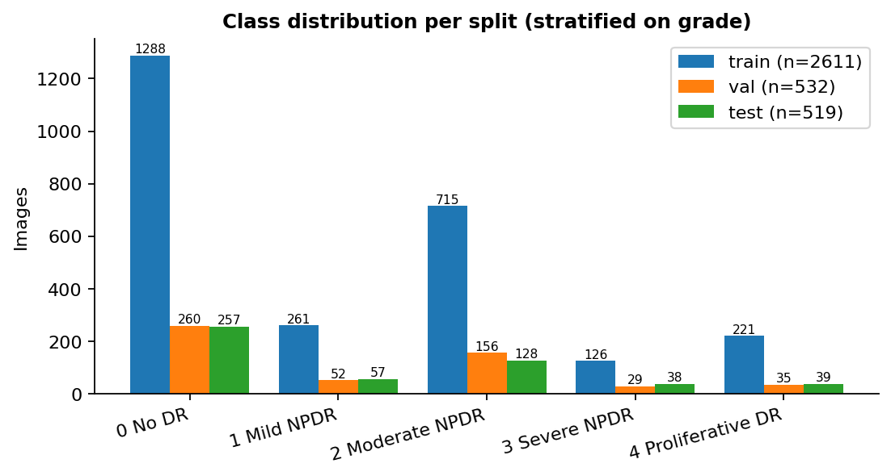
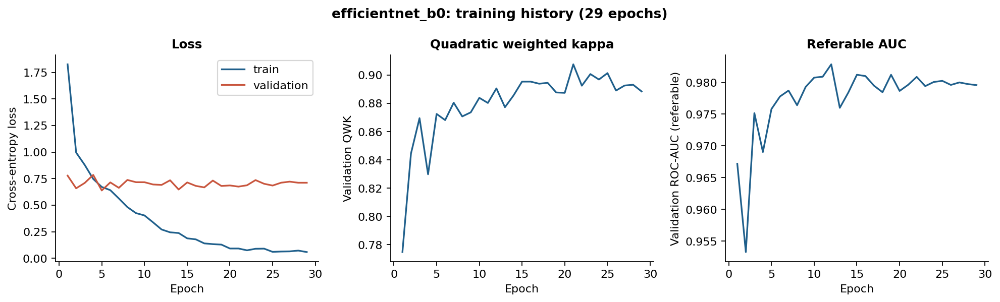
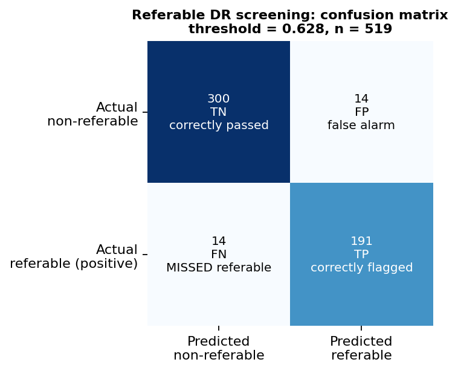
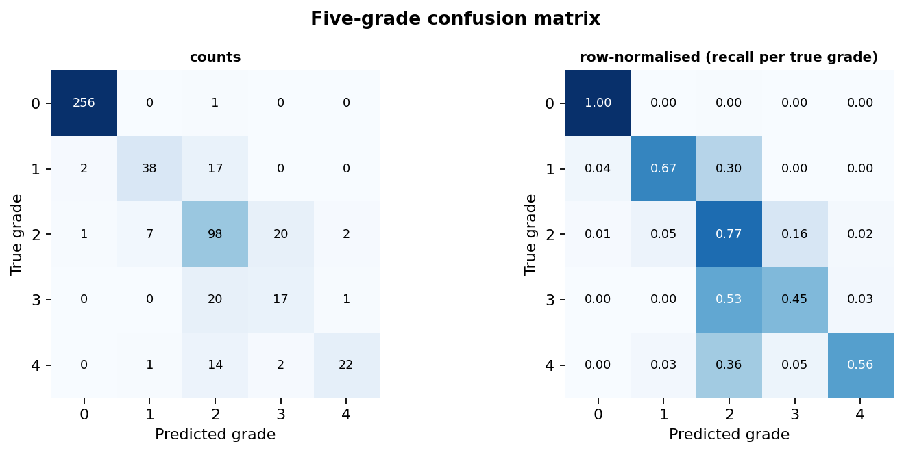
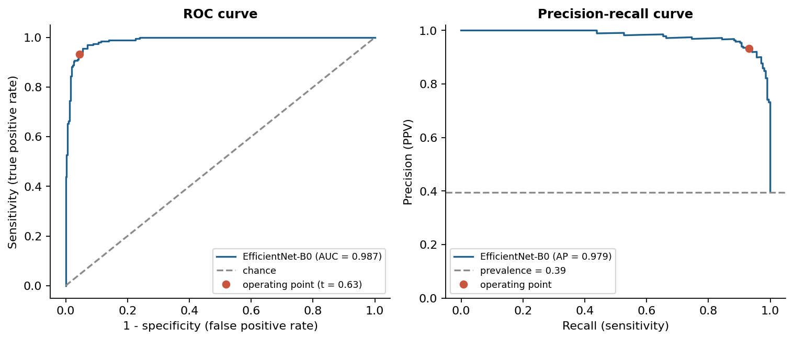
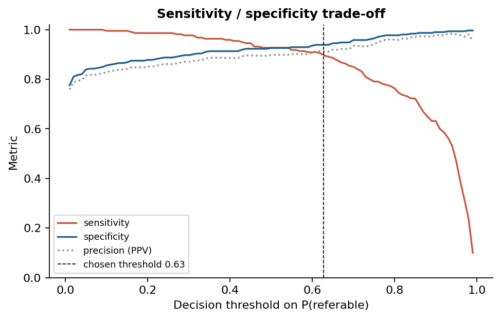
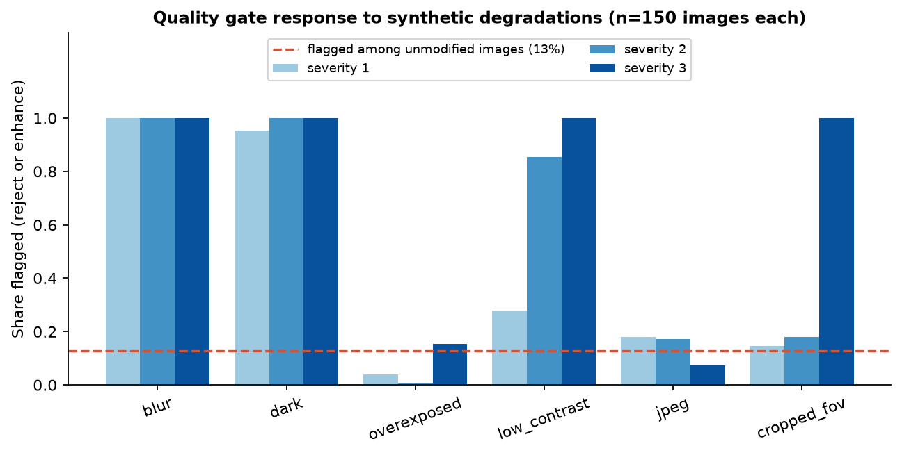
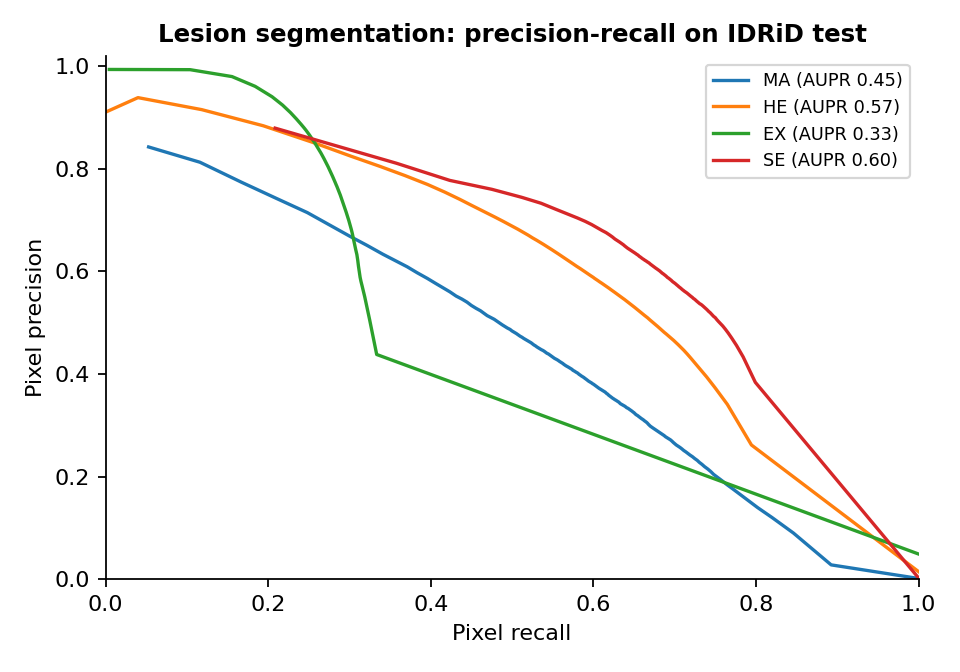
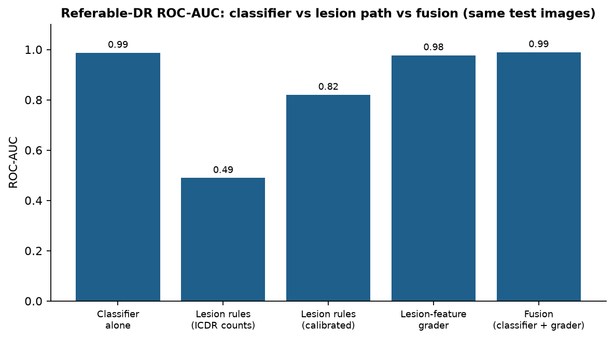
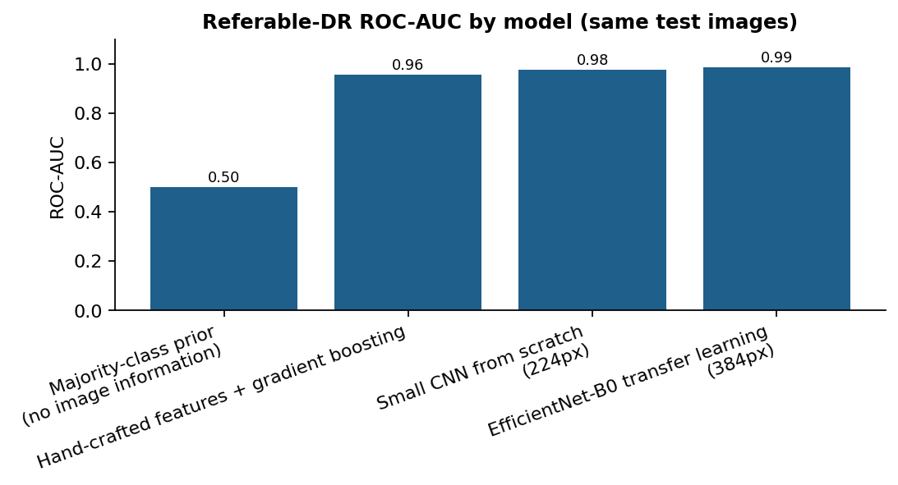

## Abstract

Diabetic retinopathy (DR) is a leading preventable cause of vision loss among people with diabetes, and screening programmes depend on grading large numbers of retinal photographs. This project is an academic prototype of an automated screening pipeline. An ImageNet-pretrained EfficientNet-B0 [6] is fine-tuned on the APTOS 2019 dataset [11] to predict the five International Clinical DR (ICDR) severity grades [5], from which a referable-DR decision (grade 2 or higher) is derived. The pipeline adds a heuristic image-quality gate, Grad-CAM visual explanations [7], temperature-scaled confidence [8], a lesion-evidence pathway (an IDRiD-trained lesion segmentation network and optic-disc/fovea locator feeding an ICDR rule engine that states its reasons), a discrete-event simulation of a screening workflow, and a Gradio demonstration application. Training and evaluation were run remotely on a Kaggle GPU (Tesla T4). On the internal held-out test split of 519 images the referable-DR sensitivity was 0.932 and specificity 0.955 at a threshold chosen on validation data only, with a ROC-AUC of 0.987 and a quadratic weighted kappa of 0.910 on the five grades. These are **internal** results on data from the same source as the training data; they are not independent external validation and not clinical validation. On a small independent test on IDRiD (100 images, a different camera and grading protocol) the same classifier reached a sensitivity of only 0.770 (specificity 0.897, ROC-AUC 0.895), so the internal figures overstate what should be expected on other data. Follow-up experiments, each judged by a decision rule written down before its results were seen, added an EfficientNet-B3 plus flip test-time-augmentation ensemble (adopted as the application default), a robustness-augmented model (adopted for the degraded-image case), a second lesion model trained with an additional dataset (not adopted) and a model trained with additional EyePACS data [24], which raised the IDRiD ROC-AUC from 0.876 to 0.917 but failed the pre-set in-domain non-inferiority criterion and is therefore offered only as an optional model.

> This project is an academic research prototype for diabetic retinopathy screening. Its outputs are not a medical diagnosis and must not be used as a substitute for qualified clinical assessment.

# 1. Introduction and problem statement

Diabetic retinopathy is a microvascular complication of diabetes in which long-standing hyperglycaemia damages the small blood vessels of the retina. Early disease is usually asymptomatic, while advanced disease (severe non-proliferative and proliferative DR) threatens sight and is treatable with laser photocoagulation, intravitreal anti-VEGF injection or vitreoretinal surgery when detected in time. Screening therefore aims to sort patients quickly into those who can be re-screened routinely and those who need an ophthalmologist. The international severity scale of Wilkinson et al. [5] defines five levels: no apparent retinopathy (0), mild (1), moderate (2) and severe (3) non-proliferative DR, and proliferative DR (4). In this work **referable DR** means grade 2 or higher, the definition stated in the project roadmap.

The problem addressed here is: given a colour fundus photograph, (a) decide whether the image is of sufficient quality to analyse, (b) estimate the ICDR grade, (c) derive a referable / non-referable screening decision, and (d) present the result with a visual explanation and honest, clinically interpretable performance statistics.

# 2. Motivation: automated screening and the Indian context

India has a very large population living with diabetes. The ICMR-INDIAB national cross-sectional study reported a diabetes prevalence of 11.4% (95% CI 10.2–12.5) in its analysed sample of 107,119 individuals [4]. DR prevalence in the Chennai Urban Rural Epidemiology Study eye study was 17.6% (95% CI 15.8–19.5) among people with diabetes, and 20.8% among those with previously known diabetes [3]. The Chennai study is a single-city study, so it should not be read as a national figure. Because the number of people needing periodic retinal examination far exceeds the number of available eye specialists, particularly outside cities, automated grading that can run on photographs taken in primary-care or camp settings is attractive. In the United States, a pivotal trial of an autonomous system (IDx-DR) in primary-care offices reported a sensitivity of 87.2% and specificity of 90.7% for more-than-mild DR against a reading-centre reference [2]; this shows that regulated autonomous screening is feasible, but it concerns a different system, population and protocol than this prototype and is cited for context only, not as a benchmark that this project is claimed to meet.

# 3. Objectives and scope

1. Build a reproducible, tested end-to-end pipeline from images to a screening decision.
2. Train and evaluate an EfficientNet-B0 classifier on all five grades and derive referable DR from the grade probabilities.
3. Report evaluation metrics in a form a clinician can interpret: sensitivity, specificity, predictive values, ROC/PR, confusion matrices, quadratic weighted kappa, calibration, and bootstrap confidence intervals.
4. Provide a quality gate, visual explanations, a decision-support demo, and a workflow simulation.
5. Give a clear reason for each result: detect and localise lesions with a model trained on lesion annotations (IDRiD), turn the ICDR criteria into an explicit rule engine that lists which criteria are met, not met or **not assessable**, and cross-check it against the classifier.

**In scope and implemented:** items 1–5 above. **Out of scope / not implemented:** detection of venous beading, intraretinal microvascular abnormalities (IRMA) and neovascularisation (so the rule engine can never assign grade 4), patient-level data separation (no identifiers available), and clinical validation. These limits are discussed in Section 14 and Section 19.

# 4. Related work

Gulshan et al. [1] trained a deep convolutional network on retinal photographs graded by ophthalmologists and reported, for referable DR on EyePACS-1 and Messidor-2, sensitivities of 90.3% and 87.0% with specificities of 98.1% and 98.5% at a high-specificity operating point, with ROC-AUCs of 0.991 and 0.990. Their referable definition also included referable macular oedema, and they used far larger training data than APTOS; the numbers are therefore not directly comparable to this project. The IDx-DR pivotal trial [2] evaluated an autonomous system prospectively in primary care. EfficientNet [6] scales depth, width and resolution jointly and is a common backbone for fundus-image transfer learning. Grad-CAM [7] produces coarse class-discriminative localisation maps from the gradients of a convolutional network, and the sanity checks of Adebayo et al. [18] motivate testing whether a saliency map depends on the learned weights. Guo et al. [8] showed that modern networks are often over-confident and that temperature scaling is a simple post-hoc remedy. Ben Graham's colour normalisation, popular in the Kaggle DR competitions [17], subtracts a local Gaussian-blurred average to reduce illumination differences between cameras. The IDRiD dataset [14] provides pixel-level lesion masks, optic-disc and fovea locations and image-level grades, and is used here to train and test the lesion-evidence module.

# 5. Datasets, labels and splits

## 5.1 Data source and access

The primary dataset is APTOS 2019 Blindness Detection [11], released by the Asia Pacific Tele-Ophthalmology Society as a Kaggle competition. Access to the files requires accepting the competition rules on kaggle.com; this was done by the project owner, and the data were attached to the Kaggle notebook as a competition source. Only the labelled training partition (the competition's test labels are not public) is used, and it is re-split by this project.

| Split | Images | Gr.0 | Gr.1 | Gr.2 | Gr.3 | Gr.4 | Referable prevalence |
|---|---|---|---|---|---|---|---|
| train | 2611 | 1288 | 261 | 715 | 126 | 221 | 0.407 |
| val | 532 | 260 | 52 | 156 | 29 | 35 | 0.414 |
| test | 519 | 257 | 57 | 128 | 38 | 39 | 0.395 |

## 5.2 Labels

Each image has a single grade from 0 to 4. Referable DR is derived as grade ≥ 2 (positive class). Image-level grades only are available: **no lesion annotations, no patient identifiers, no eye laterality and no image-quality labels** are provided.

## 5.3 Splits and leakage prevention

The labelled images were split into train / validation / test with a stratified (on grade), seeded, group-aware procedure. Images are grouped when they are byte-identical (MD5) or near-duplicates (16×16 difference-hash, Hamming distance ≤ 6), and each group is kept inside one split; an assertion verifies that no MD5 or group spans two splits. 150 images were merged into groups with another image. The split manifest (image id, grade, split, group) is saved with the artifacts for exact reproduction.

**Limitation.** APTOS 2019 provides no patient/eye identifiers, so patient-level (left/right eye) separation could not be enforced; only exact/near-duplicate image grouping was used. Test results may be optimistic if both eyes of a patient are present.

## 5.4 IDRiD (lesion evidence and external check)

The Indian Diabetic Retinopathy Image Dataset (IDRiD) [14] is released under CC BY 4.0. Its official release has three parts, all used here: **segmentation** (54 training and 27 test images with pixel masks for microaneurysms, haemorrhages, hard exudates, soft exudates and the optic disc), **localization** (optic-disc and fovea centres for 413 training and 103 test images) and **disease grading** (the same 516 images with a DR grade 0–4 and a macular-oedema risk label). The lesion network is trained on the 54 segmentation-training images (10 of them held out for model and threshold selection), the locator on the localization-training images, and both are evaluated only on the official test images. A missing mask file is read as "no lesion of that type in the image", the dataset's convention. The copy used is a third-party re-upload of the official release on Kaggle; I could not verify that it is byte-identical to the original distribution. IDRiD was photographed with a single camera type and is therefore not representative of APTOS's mixture of cameras.

## 5.5 EyePACS (additional training and external-domain data)

For the experiment of Section 15.3 the Kaggle *Diabetic Retinopathy Detection* (EyePACS) competition data [24] were used. Access requires accepting the competition rules, which the project owner did; the images were read inside the Kaggle notebook (never downloaded to a personal computer or redistributed), directly from the split archive. Images carry one grade per eye from 0 to 4 (a single reader per image, from a variety of clinics and cameras; the labels are noisier than those of APTOS and IDRiD). The patient identifier is encoded in the file name, so the split is **by patient**: both eyes of a patient are always in the same split. A training pool took every grade 1-4 image of the training patients plus a random sample of grade 0, and a held-out sample of test patients was kept with its natural grade mix. Every EyePACS image was checked against all APTOS validation and test images and the IDRiD grading test images by exact hash and perceptual (difference-hash) similarity so that no photograph could appear on both sides of an evaluation.

| Quantity | Value |
|---|---|
| EyePACS training images used (grades 0 / 1 / 2 / 3 / 4) | 5000 / 2048 / 4525 / 768 / 602 |
| EyePACS training patients | 8790 |
| EyePACS held-out test sample (grades 0 / 1 / 2 / 3 / 4; natural mix; patients never seen in training) | 2220 / 234 / 429 / 60 / 57 |
| EyePACS test patients | 1722 |
| Near-duplicates (dHash <= 6 bits or identical MD5) of APTOS validation/test or IDRiD test images found among 15943 EyePACS images | 0 |
| APTOS train / validation / test images (same split as every other model) | 2611 / 532 / 519 |

# 6. Image preprocessing and augmentation

Each image is read with OpenCV (corrupt, empty, grayscale-only or constant images are rejected and logged, never silently dropped), then: (1) cropped to the bounding box of the non-black retina region, (2) padded to a square, (3) resized to 384×384 pixels (area interpolation when shrinking), (4) masked with a circular field-of-view mask. The model input is further normalised with the Ben Graham transform (4·I − 4·G_σ∗I + 128 with σ = size/30 and a slightly tighter circular mask to suppress the edge ring), then ImageNet mean/standard-deviation normalisation. The preprocessed array is cached once per run.

Augmentation is applied to **training images only**: random rotation (0–360°), horizontal/vertical flips, scale 0.92–1.08, brightness and contrast jitter, and gamma. Validation and test images receive no augmentation and no test-time augmentation.

# 7. Model architecture and training

The classifier is EfficientNet-B0 [6] (timm implementation [12] on PyTorch [13], ImageNet-pretrained weights) with a five-way output layer and dropout 0.3. The five-grade softmax is the primary output; the referable probability is P(grade 2) + P(grade 3) + P(grade 4). Training used AdamW [19] (learning rate 0.0003, weight decay 0.01), a one-epoch linear warm-up followed by cosine decay, batch size 24, automatic mixed precision, gradient clipping, and class-weighted cross-entropy with weights proportional to the square root of inverse class frequency. The best checkpoint and early stopping used the validation quadratic weighted kappa (patience 8). A checkpoint containing model, optimiser, scheduler and scaler state was written every epoch.

| Item | Value |
|---|---|
| python | 3.13.15 |
| platform | Linux-6.18.55+-x86_64-with-glibc2.39 |
| torch | 2.11.0+cu128 |
| numpy | 2.1.3 |
| opencv | 4.14.0 |
| sklearn | 1.6.1 |
| cuda_available | True |
| timm | 1.0.29 |
| gpu | Tesla T4 |
| gpu_memory_gb | 15.6 |
| cuda_runtime | 12.8 |

Training ran for 29 epochs (best epoch 21; stopping reason: early stopping: no improvement in validation qwk for 8 epochs) in 1776 seconds of training time. The checkpoint was reloaded twice and produced identical logits (maximum absolute difference 0.00e+00).

**Baselines** trained on the same split for comparison: a majority-class prior, hand-crafted image statistics with gradient boosting, and a small four-block CNN trained from scratch. They quantify how much of the performance comes from transfer learning rather than from trivial image statistics.

# 8. Evaluation protocol

All headline results are computed on the held-out **test split**, which is never used for training, checkpoint selection, temperature fitting, threshold selection, or quality-gate calibration. The temperature, the operating threshold and the quality thresholds are fitted on validation (respectively training) data only.

| Quantity | Value |
|---|---|
| Rule | max specificity s.t. validation sensitivity >= 0.90 |
| Chosen threshold | 0.628 |
| Validation sensitivity at threshold | 0.900 |
| Validation specificity at threshold | 0.939 |
| Fitted on | validation |

The operating threshold on P(referable) was chosen on the validation split as the highest threshold meeting a sensitivity target of 0.90 (a design choice reflecting that missed referable cases are the costly error in screening); test performance at that fixed threshold is then reported without re-tuning. Results at the default threshold of 0.5 are also stored in `results/metrics.json`. The resulting evaluation is an **internal holdout** evaluation: test images come from the same collection, cameras and labelling process as the training images.

Confidence intervals are 95% percentile bootstrap intervals [10] (1000 replicates, seed 42) in which test images are resampled with replacement and every metric is recomputed on the same resample; replicates in which a metric is undefined (for example no positive case drawn) are skipped. Images are treated as independent. Because APTOS has no patient identifiers, the intervals may be too narrow if both eyes of a patient are in the test set.

# 9. Evaluation metrics in plain language

Let TP be referable cases flagged referable, FN referable cases passed as non-referable (**missed cases**), FP non-referable cases flagged referable (**false alarms**), and TN non-referable cases passed.

- **Sensitivity** = TP / (TP + FN). Of the truly referable patients, the share the system flagged. It is the headline screening metric because a missed referable case is the costly error.
- **Specificity** = TN / (TN + FP). Of the truly non-referable patients, the share correctly reassured. Low specificity floods reviewers with false alarms.
- **Precision (PPV)** = TP / (TP + FP). Of the flagged cases, the share that are truly referable. It depends on prevalence.
- **Negative predictive value** = TN / (TN + FN). How reassuring a "no referral" result is.
- **ROC-AUC.** The probability that a random referable case receives a higher score than a random non-referable case; it does not depend on a threshold.
- **PR-AUC (average precision).** Summarises precision against recall; more informative than ROC-AUC when positives are the minority [23].
- **Balanced accuracy** = (sensitivity + specificity) / 2, and **F1** = 2·PPV·sensitivity / (PPV + sensitivity).
- **Quadratic weighted kappa (QWK)** [9]. Agreement between predicted and true grades beyond chance, where a disagreement of d grades is penalised in proportion to d². Calling a grade-4 eye grade 0 costs sixteen times more than a one-grade error, which matches clinical intuition.
- **Dice / IoU / AUPR (lesion segmentation).** Dice (equal to pixel-level F1) = 2·TP / (2·TP + FP + FN) and IoU = TP / (TP + FP + FN) measure overlap between predicted and annotated lesion pixels at a chosen threshold; AUPR is the area under the pixel precision-recall curve over all thresholds (the IDRiD challenge metric). Lesion pixels are extremely rare, so a model can reach 99% pixel accuracy while detecting nothing; accuracy is therefore not reported for segmentation.
- **Calibration.** Expected calibration error (ECE) is the bin-size-weighted average gap between confidence and observed accuracy over 15 equal-width bins; the Brier score [22] is the mean squared error of the referable probability. A softmax output is a model score, not automatically a calibrated probability [8].

A trade-off is unavoidable: lowering the threshold raises sensitivity and lowers specificity. Which operating point is acceptable is a clinical and programme decision that this prototype does not make.

# 10. Quantitative results (internal held-out test split)

| Quantity | Value |
|---|---|
| Evaluation set | APTOS 2019 internal test split (internal holdout (same source as training)) |
| Images evaluated | 519 |
| Referable (positive) / non-referable (negative) | 205 / 314 |
| Prevalence of referable DR in this set | 0.395 |
| Operating threshold on P(referable) | 0.628 |

|  | Predicted non-referable | Predicted referable |
|---|---|---|
| **Actual non-referable** | TN = 300 | FP = 14  (false alarm) |
| **Actual referable** | FN = 14  (missed referable case) | TP = 191 |

| Metric | Measured result | 95% CI | What it means | Why it matters |
|---|---|---|---|---|
| Sensitivity (recall) | 0.932 | 0.896 to 0.964 | Of truly referable cases, the share the system flagged. | Missed referable cases (false negatives) are the costly error in screening. |
| Specificity | 0.955 | 0.933 to 0.976 | Of truly non-referable cases, the share correctly passed as non-referable. | Low specificity floods reviewers with false alarms. |
| Precision (PPV) | 0.932 | 0.897 to 0.964 | Of all cases flagged referable, the share that really were. | Depends on prevalence; tells how trustworthy a flag is. |
| Negative predictive value | 0.955 | 0.931 to 0.975 | Of cases passed as non-referable, the share that really were. | How reassuring a 'no referral' result is. |
| ROC-AUC | 0.987 | 0.979 to 0.994 | Probability a random referable case scores higher than a random non-referable case. | Threshold-free separation ability. |
| PR-AUC (average precision) | 0.979 | 0.964 to 0.991 | Area under the precision-recall curve. | More informative than ROC-AUC when referable cases are the minority. |
| Balanced accuracy | 0.944 | 0.920 to 0.963 | Mean of sensitivity and specificity. | Not distorted by class imbalance. |
| F1 score | 0.932 | 0.904 to 0.956 | Harmonic mean of precision and sensitivity. | Single number balancing flags and misses. |
| Quadratic weighted kappa | 0.910 | 0.884 to 0.930 | Agreement between predicted and true grade beyond chance; disagreements are penalised by the squared grade distance. | Predicting grade 0 for a grade 4 eye is punished far more than grade 2 vs 3. |
| Macro F1 (5 grades) | 0.713 | 0.656 to 0.758 | Unweighted mean of per-grade F1. | Rewards doing well on rare severe grades. |
| Balanced accuracy (5 grades) | 0.688 | 0.633 to 0.740 | Mean of per-grade recall. | Each grade counts equally. |
| Accuracy (5 grades, secondary) | 0.830 | 0.796 to 0.859 | Share of exact grade matches. | Misleading alone under class imbalance. |
| Expected calibration error | 0.042 | n/a | Average gap between confidence and observed accuracy over equal-width bins. | Shows whether probabilities can be read as frequencies. |
| Brier score | 0.041 | 0.031 to 0.054 | Mean squared error of the referable probability (lower is better). | Proper scoring rule: rewards honest probabilities. |

| Grade | Precision | Recall | F1 | Support |
|---|---|---|---|---|
| 0 No DR | 0.988 | 0.996 | 0.992 | 257 |
| 1 Mild NPDR | 0.826 | 0.667 | 0.738 | 57 |
| 2 Moderate NPDR | 0.653 | 0.766 | 0.705 | 128 |
| 3 Severe NPDR | 0.436 | 0.447 | 0.442 | 38 |
| 4 Proliferative DR | 0.880 | 0.564 | 0.688 | 39 |

**Reading these results.** At the validation-selected threshold (0.628) the system flagged 0.932 of the 205 truly referable test images (so 14 referable cases were missed) and correctly passed 0.955 of the 314 non-referable images (14 false alarms). The sensitivity target of 0.90 was set on validation data; the test sensitivity is not tuned and is reported with its bootstrap interval. These are internal holdout numbers on a single-source dataset. The project roadmap states a target for *external* data (sensitivity above 90% and specificity above 85%); that target is **not met** on the only independent check available (Section 14.5: sensitivity 0.770, 95% CI 0.661 to 0.869 on 100 IDRiD images), and the internal numbers must not be read as evidence that it would be. Published systems (for example [1] and [2]) used different data, definitions and protocols, so these numbers must not be ranked against them.

Referable-versus-non-referable screening is much stronger than fine-grained grading. The quadratic weighted kappa is 0.910, but the macro-averaged F1 over the five grades is only 0.713 and the balanced five-grade accuracy 0.688: the classifier recognises grade 0 almost perfectly (recall 0.996) but is weaker on mild disease (grade 1 recall 0.667), severe NPDR (grade 3 recall 0.447, only 38 test images) and proliferative DR (grade 4 recall 0.564, 39 images). The errors are mostly one or two grades apart (Figure 5), which is why QWK stays high, and many proliferative cases are graded as moderate: such an eye is still flagged referable, but the *urgency* would be under-stated. Grades 3 and 4 are rare in the data and the intervals for those rows are wide.

For reference, the validation-split numbers are stored separately in `results/metrics.json` under `validation_split_reference` and are not unbiased because that split was used for model selection.

# 11. Curves, confusion matrices and calibration

## Calibration

| Quantity | Before temperature scaling | After temperature scaling |
|---|---|---|
| ECE (5-grade top-label, 15 equal-width bins) | 0.103 | 0.042 |
| ECE (referable, 15 bins) | 0.033 | 0.023 |
| Brier score (referable probability) | 0.043 | 0.041 |
| NLL (5-grade) | 0.667 | 0.445 |

Temperature scaling (T = 2.69, fitted on validation) reduced the five-grade top-label ECE from 0.103 to 0.042 and the validation NLL from 0.675 to 0.441. The referable-probability ECE was already small before scaling (0.033) and improved only slightly (0.023). With 519 test images and most predictions near 0 or 1, the middle bins of the reliability diagram hold few images and are noisy. The probabilities are better calibrated on this internal split; they are not clinically validated risks.

# 12. Grad-CAM explanations

Grad-CAM [7] was implemented from first principles with forward and backward hooks on the last convolutional feature map (before global pooling): the map is the ReLU of the sum of feature maps weighted by their spatially averaged gradients of the predicted-grade score, up-sampled to the input size and masked to the field of view.

**Interpretation limits.** A Grad-CAM map shows where this particular network's output is sensitive. It is not evidence that a lesion is present, that the model reasons as a clinician does, or that a highlighted region is pathological. As a sanity check, the map of the trained model was compared with that of a weight-randomised copy on three images (Spearman correlation 0.145; values near zero indicate that the map depends on the learned weights); this is a weak, indicative test on a handful of images.

# 13. Image-quality gate

`quality.py` implements a **heuristic** gate: sharpness (variance of the Laplacian of the green channel inside the eroded field of view at a fixed 512-pixel scale), mean illumination, contrast, saturation, and field-of-view completeness. It returns `good`, `enhance` (contrast enhancement with CLAHE [20] is applied before analysis) or `reject`, with a reason. It is **not** a model trained on genuine quality labels such as EyeQ; thresholds are set from training-set percentiles and are therefore distribution-relative, not clinically validated.

| Status on unmodified test images | Count | Share |
|---|---|---|
| good | 452 | 87.1% |
| enhance | 48 | 9.2% |
| reject | 19 | 3.7% |

| Degradation | Severity | N | Gate: reject | Gate: enhance | Gate: good |
|---|---|---|---|---|---|
| blur | 1 | 150 | 100.0% | 0.0% | 0.0% |
| blur | 2 | 150 | 100.0% | 0.0% | 0.0% |
| blur | 3 | 150 | 100.0% | 0.0% | 0.0% |
| dark | 1 | 150 | 48.0% | 47.3% | 4.7% |
| dark | 2 | 150 | 94.7% | 5.3% | 0.0% |
| dark | 3 | 150 | 98.0% | 2.0% | 0.0% |
| overexposed | 1 | 150 | 1.3% | 2.7% | 96.0% |
| overexposed | 2 | 150 | 0.7% | 0.0% | 99.3% |
| overexposed | 3 | 150 | 15.3% | 0.0% | 84.7% |
| low_contrast | 1 | 150 | 28.0% | 0.0% | 72.0% |
| low_contrast | 2 | 150 | 85.3% | 0.0% | 14.7% |
| low_contrast | 3 | 150 | 100.0% | 0.0% | 0.0% |
| jpeg | 1 | 150 | 5.3% | 12.7% | 82.0% |
| jpeg | 2 | 150 | 5.3% | 12.0% | 82.7% |
| jpeg | 3 | 150 | 1.3% | 6.0% | 92.7% |
| cropped_fov | 1 | 150 | 6.0% | 8.7% | 85.3% |
| cropped_fov | 2 | 150 | 9.3% | 8.7% | 82.0% |
| cropped_fov | 3 | 150 | 100.0% | 0.0% | 0.0% |

On the 519 unmodified test images the gate marked 452 good, 48 enhance and 19 reject. The synthetic-degradation chart shows what it can and cannot see: blur, darkness and low contrast are caught at nearly every severity, a severe top-edge crop is caught only at the highest severity, and **over-exposure and JPEG compression are essentially invisible to it**. The gate's response to synthetic degradations shows only that it reacts to those specific, artificial defects; it says nothing about agreement with human graders of real image quality.

The table below shows why the gate matters. It uses a grade-stratified subset (so its absolute numbers are not comparable with the headline test results). Without the gate, a blurred image is silently classified as healthy (the sensitivity collapses), while the gate rejects every one of them. Conversely, heavy JPEG compression makes the classifier call almost every image referable (specificity near zero) and the gate does not notice, so this is a real robustness weakness of the classifier that the gate does not cover.

| Condition (grade-stratified subset) | N | Rejected by gate | Ungated sens. | Ungated spec. | Ungated AUC | Analysed-only sens. | Analysed-only spec. |
|---|---|---|---|---|---|---|---|
| clean (same subset) | 150 | 7% | 0.96 | 0.80 | 0.96 | 0.95 | 0.80 |
| blur (severity 2) | 150 | 100% | 0.02 | 1.00 | 0.81 | n/a (all rejected) | n/a (all rejected) |
| dark (severity 2) | 150 | 95% | 0.94 | 0.82 | 0.94 | 1.00 | 1.00 |
| overexposed (severity 2) | 150 | 1% | 0.97 | 0.70 | 0.91 | 0.97 | 0.70 |
| low_contrast (severity 2) | 150 | 85% | 0.93 | 0.77 | 0.92 | 1.00 | 0.67 |
| jpeg (severity 2) | 150 | 5% | 1.00 | 0.05 | 0.81 | 1.00 | 0.05 |
| cropped_fov (severity 2) | 150 | 9% | 0.93 | 0.87 | 0.96 | 0.94 | 0.89 |

On clean test images, running the full gated pipeline (contrast enhancement for 'enhance' images, rejected images counted as referred) gave a slightly lower sensitivity and specificity than the classifier alone (Section 15), so the enhancement step did not help on this data; its benefit, if any, is for genuinely poor images and was not demonstrated here.

# 14. Lesion evidence, rule engine and fusion

**Why.** A classifier's grade has no explanation attached. The lesion pathway produces the evidence a clinician looks for: where microaneurysms, haemorrhages and exudates are, how many, and in which part of the retina, and then applies the ICDR criteria to that evidence in code so that the reason for a grade can be read.

## 14.1 Lesion segmentation network

A U-Net with an ImageNet-pretrained EfficientNet-B0 encoder and a full-resolution output stem predicts five masks (microaneurysm MA, haemorrhage HE, hard exudate EX, soft exudate SE, optic disc OD) as independent sigmoid channels. Each image is cropped to the retina, padded and resized to a 1280-pixel canvas (so scale is normalised by retina size, not by camera resolution) and Ben Graham-normalised. Training uses random 512×512 crops, 60% centred on a lesion pixel, flips and 90° rotations, a class-weighted binary cross-entropy plus soft-Dice loss, and mixed precision. Pixel thresholds were chosen on the 10 validation images; **all numbers below are on the 27 official IDRiD test images**, which were never used for training or selection.

| Structure | AUPR | Dice (pixel F1) | IoU | Precision | Recall | Threshold (val.) | Test images containing it |
|---|---|---|---|---|---|---|---|
| Microaneurysms | 0.446 | 0.491 | 0.325 | 0.467 | 0.517 | 0.80 | 27 |
| Haemorrhages | 0.569 | 0.590 | 0.418 | 0.554 | 0.630 | 0.44 | 27 |
| Hard exudates | 0.332 | 0.396 | 0.247 | 0.847 | 0.259 | 0.90 | 27 |
| Soft exudates | 0.598 | 0.642 | 0.473 | 0.624 | 0.661 | 0.80 | 14 |
| Optic disc | 0.979 | 0.954 | 0.913 | 0.938 | 0.971 | 0.39 | 27 |

Small structures (microaneurysms) are the hardest at this resolution; the table shows the measured performance and should be read as such. Only the held-out IDRiD performance measures lesion detection.

## 14.2 Optic-disc and fovea locator, and quadrants

An EfficientNet-B0 regressor predicts the optic-disc and fovea centres. They define the frame for the quadrant analysis: the line from the disc through the fovea is the horizontal axis, a perpendicular through the fovea is the vertical axis, and "superior" is the side that is up in the image. This is an approximation of the clinical quadrants for an upright photograph, not a validated definition. Distances are expressed in optic-disc diameters (measured from the predicted disc mask).

The regressor alone generalised only partly to APTOS: in visual checks of APTOS overlays its optic-disc estimate was often visibly off the disc (APTOS has no disc annotations, so this could not be quantified). The deployed method therefore takes the disc position from the **segmented disc** (Dice 0.954 on IDRiD test) and uses the regressor's fovea only when its disc estimate agrees with the segmented disc to within one disc diameter; otherwise the fovea is placed by an anatomical prior (about 2.5 disc diameters from the disc toward the centre of the retina). The prior was needed for 1.0% of the IDRiD test images and for 5.2% of all APTOS images.

| Quantity (IDRiD test, original pixels) | Regressor alone | Deployed method (segmented disc; regressor or prior fovea) |
|---|---|---|
| Images | 103 | 103 |
| Optic-disc centre error, mean / median (px) | 89.1 / 78.8 | 26.3 / 23.3 |
| Fovea centre error, mean / median (px) | 132.9 / 116.1 | 140.2 / 128.5 |
| Approx. optic-disc diameter (px) | 527 | 500 |
| Fovea within one disc diameter of ground truth | 100.0% | 100.0% |
| Optic disc within one disc diameter of ground truth | 100.0% | 100.0% |

## 14.3 ICDR rule engine

`rules.py` turns the detected lesions into a grade with reasons. The rules are: no lesion found, grade 0; microaneurysms only, grade 1; any haemorrhage, hard exudate or soft exudate (more than microaneurysms alone) grade 2; haemorrhage-like regions in all four quadrants at or above a per-quadrant count (the '4' of the 4-2-1 rule), grade 3. A macular-involvement indicator is raised when hard exudates lie within one disc diameter of the estimated fovea. For every image the engine prints which criteria were met, not met, or **not assessed**: venous beading, IRMA and neovascularisation cannot be assessed because no detector for them exists in this project, so **the rule engine can never assign grade 4**, and a rule-derived grade 3 rests on the haemorrhage criterion alone. Two threshold sets are evaluated: the literal ICDR counts (at least 1 region of each type; at least 20 haemorrhages per quadrant) and a data-calibrated set whose counts are fitted on the APTOS training split only.

| Rule variant | min MA | min HE | min EX | min SE | HE per quadrant ('4' of 4-2-1) |
|---|---|---|---|---|---|
| ICDR-literal | 1 | 1 | 1 | 1 | 20 |
| data-calibrated (fitted on training split) | 12 | 200 | 50 | 5 | 80 |

The calibrated thresholds are fitted to this detector's output on APTOS, not to clinical practice (they can look absurd as clinical counts), and the report text produced by the application says so.

## 14.4 Evidence fused with the classifier

The classifier and the lesion path are compared and combined on the **same held-out APTOS test images**. Everything tunable is fitted on training or validation rows only: the calibrated rule counts and a gradient-boosting grader on the lesion features (training split), the fusion weight and thresholds (validation split). The lesion model was trained on IDRiD and is applied to APTOS without any APTOS lesion annotation, so its APTOS detections are an unvalidated domain transfer; their value is measured here only indirectly, through agreement with the APTOS grade.

| Configuration | N | Sensitivity | Specificity | ROC-AUC | QWK (5-grade) | FN (missed) |
|---|---|---|---|---|---|---|
| EfficientNet-B0 classifier alone | 519 | 0.932 | 0.955 | 0.987 | 0.910 | 14 |
| Lesion rules alone (ICDR-literal) | 519 | 1.000 | 0.000 | 0.489 | -0.008 | 0 |
| Lesion rules alone (data-calibrated (fitted on training split)) | 519 | 0.766 | 0.755 | 0.820 | 0.527 | 48 |
| Lesion features + gradient boosting | 519 | 0.912 | 0.930 | 0.977 | 0.776 | 18 |
| Fusion: classifier (w=0.6) + lesion-feature grader | 519 | 0.922 | 0.962 | 0.989 | 0.880 | 16 |
| Classifier + lesion-evidence escalation (ICDR-literal) | 519 | 1.000 | 0.000 | n/a | n/a | 0 |
| Classifier + lesion-evidence escalation (data-calibrated (fitted on training split)) | 519 | 0.941 | 0.729 | n/a | n/a | 12 |

| Comparison | Metric | Difference | 95% CI | Interval excludes 0 |
|---|---|---|---|---|
| Fusion minus classifier | ROC-AUC | +0.002 | -0.002 to +0.006 | no |
| Fusion minus classifier | QWK | -0.030 | -0.062 to -0.001 | yes |
| Lesion-feature grader minus classifier | ROC-AUC | -0.010 | -0.020 to -0.001 | yes |
| Lesion-feature grader minus classifier | QWK | -0.134 | -0.183 to -0.088 | yes |

**Cross-check policy.** When the lesion rules indicate referable disease but the classifier does not, the case is escalated to human review (a possible missed case); when the classifier flags a case but no supporting lesions are found, the flag is kept and the lack of corroboration is stated. The table shows how often the two agree, whether the classifier is wrong more often when they disagree, and what escalation costs and gains in terms of extra referrals and rescued referable cases.

| Rule variant | Agree | Lesions only | Classifier only | Classifier error when agree | when disagree | FN classifier alone | FN with escalation | Extra referrals | Referable cases rescued |
|---|---|---|---|---|---|---|---|---|---|
| literal | 205 | 314 | 0 | 0.068 | 0.045 | 14 | 0 | 314 | 14 |
| calibrated | 402 | 73 | 44 | 0.045 | 0.085 | 14 | 12 | 73 | 2 |

**What the lesion path adds, measured.** The literal ICDR counts are unusable on APTOS: the detector finds at least one lesion region in almost every image, so the rule calls nearly everything referable. Counts fitted on the training split (a high haemorrhage count per quadrant and tens of exudate regions, reflecting that detected-region counts are far larger than clinical counts) give moderate agreement (QWK 0.527 on the test split), much weaker than the classifier (0.910). A gradient-boosting grader on the same lesion features does much better (ROC-AUC 0.977), so the detected lesions do carry real information, but it remains significantly below the classifier (paired AUC difference -0.010, interval -0.020 to -0.001). **Fusing the two did not improve screening:** the ROC-AUC difference is +0.002 (interval -0.002 to +0.006, including zero) and the five-grade QWK is slightly lower (-0.030, interval -0.062 to -0.001). The lesion pathway is therefore justified here by what it *explains*, not by better accuracy.

As an uncertainty signal, disagreement between the classifier and the (calibrated) lesion rules is mildly informative: the classifier errs on 8.5% of the cases where they disagree against 4.5% where they agree. Escalating the 73 cases in which the rules say referable but the classifier does not would rescue only 2 of the 14 missed referable cases while adding 73 extra referrals, a poor trade at this accuracy of the rules, so the escalation policy is implemented and reported but not recommended on this evidence.

## 14.5 Independent check on IDRiD grading images

IDRiD's grading test images were never used to fit the classifier, the rule thresholds or the gradient-boosting grader (images that are near-duplicates of the lesion model's training images are excluded to avoid leakage). This is a small external evaluation of the whole pipeline on a different camera and grading protocol, so its confidence intervals are wide and the result should be read as a consistency check, not as validation.

| Quantity | Value |
|---|---|
| Dataset | IDRiD disease-grading test split |
| Evaluation type | EXTERNAL (never used for training or selection of the classifier or rule thresholds) |
| Test images in split | 103 |
| Excluded (duplicates of lesion-model training images) | 3 |
| Evaluated | 100 |
| Referable prevalence | 0.610 |
| Macular-involvement proxy ROC-AUC (EX within 1 disc diameter of fovea vs IDRiD oedema risk) | 0.797 |

| Configuration | N | Sensitivity | Specificity | ROC-AUC | QWK (5-grade) |
|---|---|---|---|---|---|
| EfficientNet-B0 classifier alone | 100 | 0.770 | 0.897 | 0.895 | 0.647 |
| Lesion rules alone (ICDR-literal) | 100 | 1.000 | 0.000 | 0.508 | 0.021 |
| Lesion rules alone (data-calibrated (fitted on training split)) | 100 | 0.525 | 1.000 | 0.851 | 0.425 |
| Lesion features + gradient boosting (APTOS-trained) | 100 | 0.689 | 0.949 | 0.897 | 0.653 |

**What the independent check shows.** Performance drops substantially away from APTOS. On these 100 images (referable prevalence 0.61, higher than in APTOS) the classifier, using the threshold and temperature fitted on APTOS validation data and nothing tuned on IDRiD, reaches sensitivity 0.770 (95% CI 0.661 to 0.869), specificity 0.897 (0.795 to 0.976), ROC-AUC 0.895 (0.830 to 0.949) and QWK 0.647. The ROC-AUC shows that the ranking of cases is largely retained, but at the APTOS-derived operating point too many referable cases are missed; the fixed threshold does not transfer to a different camera and population. The lesion-feature grader trained on APTOS has a similar AUC (0.897) and the rules fitted on APTOS counts transfer poorly (very high specificity, low sensitivity). The macular-involvement indicator (hard exudates within one disc diameter of the estimated fovea) separates IDRiD's macular-oedema-risk labels with a ROC-AUC of 0.797, modest evidence that it tracks something real. With only 100 images the intervals are wide.

Figure 11d shows a systematic failure of the lesion model on APTOS. In several images with uneven illumination (a dark or over-bright sector), a large part of the retina is marked as haemorrhage (the big orange regions): these are false positives caused by domain shift to cameras and exposure conditions that IDRiD does not cover. They add large "haemorrhage" areas but few separate regions, so they distort the region counts used by the rules in unpredictable ways, and they are one reason the rule-derived grade agrees with the reference grade in only 2 of the 10 unselected example images shown. The disc and fovea markers, in contrast, sit plausibly in most of the examples.

## 14.6 What the screening report now says

The application and `Predictor.predict` return, in addition to the grade and referable decision: the lesion overlay, the per-type lesion counts by quadrant, the ICDR checklist with met / not-met / not-assessed status, the rule-derived grade with its reasons, the macular-involvement indicator, and the cross-check with the classifier. Lesion detections are evidence for a clinician to check, not verified findings.

Image: APTOS test image `042470a92154` (true grade 3), first grade-3 image in the test split.

### Image quality: **GOOD** (heuristic score 0.60)
sharpness, illumination, contrast and field of view are acceptable

### Screening result: **REFERABLE DR suspected**
- Decision: **refer**. P(referable) 0.96 >= threshold 0.63
- Classifier's predicted grade: **2 Moderate NPDR** (argmax of a CNN; it does not by itself explain why)
- P(referable) = **96.1%** (sum of P(grade 2-4); operating threshold 0.63)
- Grade probabilities: 0 No DR: 2.0%, 1 Mild NPDR: 1.9%, 2 Moderate NPDR: 76.9%, 3 Severe NPDR: 12.1%, 4 Proliferative DR: 7.1%
- Probabilities are temperature-scaled (T = 2.69, fitted on validation data); they are model scores, not clinically validated probabilities.
- Referral policy (illustrative): Refer to an eye specialist.

### Why: lesion evidence
**Lesion-rule grade: 2 (2 Moderate NPDR)**, rule-derived from detected lesions (data-calibrated (fitted on training split) thresholds)

- Lesions beyond microaneurysms were detected: 109 hard-exudate region(s). More than microaneurysms alone but the 4-2-1 haemorrhage criterion is not met: moderate NPDR.

| ICDR criterion | Status | Detail |
|---|---|---|
| Microaneurysms present | not met | 4 detected region(s) (needs >= 12) |
| Haemorrhages present | not met | 32 detected region(s) (needs >= 200) |
| Hard exudates present | met | 109 detected region(s) (needs >= 50) |
| Soft exudates (cotton-wool spots) present | not met | 3 detected region(s) (needs >= 5) |
| 4-2-1 rule, '4': haemorrhages in all 4 quadrants | not met | haemorrhage regions per quadrant: temporal-superior 7, temporal-inferior 1, nasal-superior 12, nasal-inferior 12 (needs >= 80 in each) |
| 4-2-1 rule, '2': venous beading in 2 quadrants | not assessed | no venous-beading detector in this project |
| 4-2-1 rule, '1': IRMA in 1 quadrant | not assessed | no IRMA detector in this project |
| Proliferative disease (neovascularisation / vitreous haemorrhage) | not assessed | no neovascularisation detector; grade 4 cannot be assigned by rules |

_The count thresholds above are calibrated to this detector's output on APTOS images; counts of detected regions are not clinical lesion counts (the detector fragments and over-detects lesions), so they should not be read as clinical cut-offs._

- Macular-involvement indicator: 31 hard-exudate region(s) within one disc diameter of the estimated fovea: possible macular involvement (macular oedema risk indicator, not a diagnosis; fovea position is model-estimated)

**Cross-check with the classifier:** The classifier and the lesion rules reach the same referable / non-referable decision.

_Localisation: Optic disc: segmented; fovea: predicted by the locator and consistent with the segmented disc._

_Lesion detections come from a model trained on IDRiD and applied to this image without lesion ground truth; they are evidence to be checked by a clinician, not verified findings. Venous beading, IRMA and neovascularisation are not assessed._

Overlay colours: red = microaneurysm, orange = haemorrhage, yellow = hard exudate, cyan = soft exudate; blue ring = optic disc, green cross = estimated fovea, white lines = quadrant axes.

**Grad-CAM** highlights image regions that influenced the classifier's score. It does not prove a lesion is present or that the model reasons like a clinician.

_This project is an academic research prototype for diabetic retinopathy screening. Its outputs are not a medical diagnosis and must not be used as a substitute for qualified clinical assessment._

## 14.7 Lesion model v2 (trained with an additional dataset; not adopted)

Section 14.5 showed false lesion detections on APTOS images with uneven illumination. A second lesion model was therefore trained to address that: IDRiD plus the e-ophtha lesion data [25] (microaneurysm and exudate masks plus healthy images from other clinics and cameras; obtained from a public mirror that declares an MIT licence, whose original distributor terms were not independently verified), a loss that ignores lesion types a source does not annotate (partial labels), augmentation that imitates acquisition differences (illumination, colour and contrast changes), and a filter that discards implausibly large regions. Whether to adopt it was decided by a rule written down beforehand: **adopt v2 only if (a) its mean AUPR on the IDRiD test images is not more than 0.03 below the deployed v1, and (b) the rule engine's agreement with the expert APTOS grade on the validation rows improves by at least 0.03.**

| IDRiD test structure | AUPR v1 (deployed) | AUPR v2 | e-ophtha test AUPR (v2 only) |
|---|---|---|---|
| Microaneurysms | 0.446 | 0.395 | 0.370 |
| Haemorrhages | 0.569 | 0.498 | n/a |
| Hard exudates | 0.332 | 0.314 | 0.516 |
| Soft exudates | 0.598 | 0.477 | n/a |
| Optic disc | 0.979 | 0.947 | n/a |
| **Mean of MA, HE, EX, SE** | **0.486** | **0.421** |  |

| On APTOS (lesion detections transferred without APTOS lesion labels) | v1 (deployed) | v2 |
|---|---|---|
| Rule-engine QWK, validation rows (rule counts fitted on training rows) | 0.536 | 0.804 |
| Rule-engine QWK, test rows | 0.527 | 0.809 |
| Gradient-boosting grader on lesion features, ROC-AUC (val / test) | 0.978 / 0.977 | 0.975 / 0.979 |
| Grade-0 images with >= 20 detected haemorrhage regions (false-positive proxy) | 28.8% | 5.9% |
| Grade-0 images: mean detected hard-exudate regions | 28.6 | 9.5 |

| Pre-set criterion | Outcome |
|---|---|
| (a) mean IDRiD-test AUPR not more than 0.03 below v1 | -0.065: not met |
| (b) rule-engine QWK on APTOS validation improves by >= 0.03 | +0.268: met |
| Decision | keep v1 (v2 not adopted) |

**Reading the result honestly.** v2 is a clearly worse segmenter on the IDRiD test images it was originally measured on (mean AUPR 0.421 against 0.486), so criterion (a) fails and by the pre-set rule v1 stays deployed. At the same time, v2 produces far fewer implausible detections on healthy APTOS images (the share of grade-0 images with at least 20 detected haemorrhage regions falls from 28.8% to 5.9%) and its rule-derived grade agrees much better with the APTOS grade (validation QWK 0.536 to 0.804; test 0.527 to 0.809). The two criteria therefore point in opposite directions. The APTOS figures are an indirect measure (no APTOS lesion annotations exist), the rule thresholds are refitted on APTOS training rows, and the IDRiD AUPR drop measures the actual segmentation task; I therefore did not override the rule. The v2 weights and features are kept in the project's output folder as a documented alternative, and the finding that more diverse training data reduce false detections on a different camera while costing some in-domain segmentation accuracy is itself a result of this work. The gradient-boosting grader on the lesion features is unchanged in quality (ROC-AUC 0.977 against 0.979 on the test rows).

# 15. Ablation and baseline comparison

| Model | Sensitivity | Specificity | ROC-AUC | QWK | Operating threshold |
|---|---|---|---|---|---|
| Majority-class prior (no image information) | 1.000 | 0.000 | 0.500 | 0.000 | 0.407 |
| Hand-crafted features + gradient boosting | 0.941 | 0.834 | 0.958 | 0.755 | 0.204 |
| Small CNN from scratch (224px) | 0.961 | 0.904 | 0.978 | 0.850 | 0.278 |
| EfficientNet-B0 transfer learning (384px) | 0.932 | 0.955 | 0.987 | 0.910 | 0.628 |

| Configuration | N | Sensitivity | Specificity | ROC-AUC | QWK (5-grade) | Auto-decided | Notes |
|---|---|---|---|---|---|---|---|
| Majority-class prior (no image information) | 519 | 1.000 | 0.000 | 0.500 | 0.000 | all | threshold from validation (sens >= 0.90 rule) |
| Hand-crafted features + gradient boosting | 519 | 0.941 | 0.834 | 0.958 | 0.755 | all | threshold from validation (sens >= 0.90 rule) |
| Small CNN from scratch (224px) | 519 | 0.961 | 0.904 | 0.978 | 0.850 | all | threshold from validation (sens >= 0.90 rule) |
| EfficientNet-B0 transfer learning (384px) | 519 | 0.932 | 0.955 | 0.987 | 0.910 | all | threshold from validation (sens >= 0.90 rule) |
| EfficientNet-B0 + quality gate (rejected counted as referred) | 519 | 0.917 | 0.930 | n/a | n/a | 96.3% auto (19 recapture, 0 review) | conservative accounting; AUC/QWK not defined for the decision pipeline |
| EfficientNet-B0 + quality gate + human-review band (both counted as referred) | 519 | 0.941 | 0.911 | n/a | n/a | 88.6% auto (19 recapture, 40 review) | conservative accounting; AUC/QWK not defined for the decision pipeline |

**Paired bootstrap of metric differences (same test images, 500 resamples).**

| Comparison | Metric | Difference | 95% CI | Interval excludes 0 |
|---|---|---|---|---|
| EfficientNet-B0 minus Majority-class prior (no image information) | ROC-AUC | +0.487 | +0.479 to +0.493 | yes |
| EfficientNet-B0 minus Majority-class prior (no image information) | QWK | +0.910 | +0.883 to +0.931 | yes |
| EfficientNet-B0 minus Hand-crafted features + gradient boosting | ROC-AUC | +0.030 | +0.016 to +0.047 | yes |
| EfficientNet-B0 minus Hand-crafted features + gradient boosting | QWK | +0.155 | +0.108 to +0.202 | yes |
| EfficientNet-B0 minus Small CNN from scratch (224px) | ROC-AUC | +0.009 | -0.001 to +0.021 | no |
| EfficientNet-B0 minus Small CNN from scratch (224px) | QWK | +0.060 | +0.022 to +0.096 | yes |

Rows labelled with the quality gate use **conservative accounting**: images that the gate rejects ("recapture") or that fall in the confidence band around the threshold ("human review") are counted as referred, so that every image receives an outcome and nothing is dropped from the denominator. No lesion-evidence or lesion–CNN fusion row exists because that pathway was not implemented. Claims of improvement are made only where the paired-bootstrap interval below excludes zero. Transfer learning with EfficientNet-B0 improved the five-grade agreement over a small CNN trained from scratch (QWK difference +0.060, 95% CI +0.022 to +0.096), but for the referable ROC-AUC alone the difference (+0.009, interval -0.001 to +0.021) is not distinguishable from zero on this test set. Hand-crafted image statistics with gradient boosting are clearly weaker. The gated pipeline rows show a trade-off rather than an improvement: counting rejected and borderline cases as referred raises referrals (lower specificity) and, here, did not raise sensitivity.

## 15.1 Robustness-augmented training (comparison)

The degraded-image experiment in Section 13 showed that the standard classifier fails silently under some defects: it calls blurred images healthy, and it calls almost every heavily JPEG-compressed image referable. A second EfficientNet-B0 was therefore trained with exactly the same data split, architecture, schedule and seed, changing only the **training** augmentation: Gaussian blur (25% of images), JPEG re-compression at quality 8-60 (30%), wider darkening / contrast / washed-out illumination changes (30%) and over-exposure (15%), on top of the standard rotations and flips. Validation and test images receive no augmentation. The two models are compared on the same 519 clean test images with a paired bootstrap, and on the same degraded images through the same code path. The decision rule for recommending the robust model was written down before the results were seen.

| Model (clean test split, own validation-selected threshold) | Threshold | Sensitivity | Specificity | ROC-AUC | PR-AUC | QWK | Macro-F1 | ECE (5-grade) |
|---|---|---|---|---|---|---|---|---|
| standard | 0.628 | 0.932 | 0.955 | 0.987 | 0.979 | 0.910 | 0.713 | 0.042 |
| robust | 0.620 | 0.937 | 0.939 | 0.989 | 0.981 | 0.923 | 0.710 | 0.020 |

| Robust minus standard (same 519 test images) | Difference | 95% CI | Interval excludes 0 |
|---|---|---|---|
| roc_auc | +0.001 | -0.004 to +0.007 | no |
| qwk | +0.013 | -0.003 to +0.030 | no |
| sensitivity | +0.005 | -0.028 to +0.040 | no |
| specificity | -0.016 | -0.035 to +0.003 | no |

| Condition (grade-stratified subset, no gate) | N | Standard sens. | Standard spec. | Standard AUC | Robust sens. | Robust spec. | Robust AUC |
|---|---|---|---|---|---|---|---|
| clean (same subset) | 150 | 0.96 | 0.80 | 0.96 | 0.96 | 0.77 | 0.98 |
| blur (severity 2) | 150 | 0.02 | 1.00 | 0.81 | 0.91 | 0.80 | 0.96 |
| dark (severity 2) | 150 | 0.94 | 0.82 | 0.94 | 0.94 | 0.78 | 0.96 |
| overexposed (severity 2) | 150 | 0.97 | 0.70 | 0.91 | 0.91 | 0.85 | 0.95 |
| low_contrast (severity 2) | 150 | 0.93 | 0.77 | 0.92 | 0.93 | 0.75 | 0.93 |
| jpeg (severity 2) | 150 | 1.00 | 0.05 | 0.81 | 0.98 | 0.65 | 0.95 |
| cropped_fov (severity 2) | 150 | 0.93 | 0.87 | 0.96 | 0.91 | 0.90 | 0.97 |

| Pre-set criterion | Outcome |
|---|---|
| (a) clean test not meaningfully worse (AUC difference CI lower bound > -0.010 and QWK > -0.020) | met |
| (b) mean balanced-accuracy gain on degraded conditions >= 0.05 | +0.131: met |
| Recommendation of the rule | adopt the robust model for the demo |

**What the comparison shows.** On clean images the two models are statistically indistinguishable (all paired intervals include zero; the specificity at the operating point is -0.016 for the robust model, interval -0.035 to +0.003), and the robust model is better calibrated (five-grade ECE 0.020 versus 0.042). On degraded images it is much more reliable: sensitivity on blurred images rises from near zero to about 0.9 and specificity on JPEG-compressed images from about 0.05 to about 0.65.

**Limits of this comparison.** (1) The degradations used for testing belong to the same families as the training augmentations, which favours the robust model; gains against other real-world defects are untested. (2) Each degraded condition uses 150 images at one severity, and per-image outputs were not stored, so no confidence intervals are given for these rows; the differences are large but not formally tested. (3) JPEG robustness is improved, not solved (specificity remains well below the clean value). (4) The recommendation used test-split images (the clean non-inferiority check and the degraded subset), so the robust model's clean-test numbers are not as free of selection as those of the standard model, whose configuration was fixed before any test result was seen. For that reason the headline results in this report remain those of the standard model; the demonstration application uses the robust checkpoint (as the first member of the ensemble of Section 15.2) because the pre-set rule recommended it, and both models' numbers are reported here in full.

## 15.2 Larger backbone, ensemble and flip test-time augmentation

An EfficientNet-B3 at 448 px with the same robustness augmentation, split, schedule and seed was trained as a second backbone, and candidate ensembles were formed from it and the robust B0, with and without flip test-time augmentation (the average of the plain image and its horizontal and vertical flips). All candidates use the temperature and the threshold fitted on **APTOS validation** data only. The candidate is selected on the **validation** mean of QWK and ROC-AUC, and adopted over the current default (robust B0, no augmentation) only if its validation score is at least 0.003 higher and the paired test-split intervals show it is not worse; the test split plays no part in the selection.

| Candidate (all use APTOS-validation temperature and threshold) | Validation score | Test sens. | Test spec. | Test AUC | Test QWK | IDRiD sens. | IDRiD AUC |
|---|---|---|---|---|---|---|---|
| **B0 (robust, 384 px) + B3 (robust, 448 px) + flip TTA (selected)** | 0.9512 | 0.941 | 0.949 | 0.991 | 0.921 | 0.812 | 0.881 |
| B0 (robust, 384 px) + B3 (robust, 448 px) | 0.9504 | 0.946 | 0.943 | 0.990 | 0.917 | 0.812 | 0.877 |
| B0 (robust, 384 px) + flip TTA | 0.9458 | 0.941 | 0.936 | 0.989 | 0.922 | 0.797 | 0.883 |
| B0 (robust, 384 px) | 0.9452 | 0.937 | 0.939 | 0.989 | 0.923 | 0.766 | 0.876 |
| B3 (robust, 448 px) + flip TTA | 0.9449 | 0.951 | 0.936 | 0.989 | 0.915 | 0.797 | 0.875 |
| B3 (robust, 448 px) | 0.9439 | 0.927 | 0.933 | 0.987 | 0.920 | 0.781 | 0.871 |

| Pre-set criterion | Outcome |
|---|---|
| Validation score gain over the current default (B0 robust, no TTA) at least 0.003 | +0.0060: met |
| Not worse on the test split (paired intervals) | ROC-AUC +0.0023 (-0.0001 to +0.0050); QWK -0.0020 (-0.0178 to +0.0148): met |
| Decision | adopt the selected candidate as the application default |

The selected candidate is the B0 + B3 ensemble with flip test-time augmentation. Its gain over the previous default is small and not statistically distinguishable from zero on the test split (ROC-AUC difference +0.0023, interval -0.0001 to +0.0050; QWK difference -0.0020, interval -0.0178 to +0.0148); it satisfies the pre-set rule, which was designed to require only validation gain and non-inferiority. It costs several times the computation of a single B0 (two networks, three views of the image each; B3 at 448 px is also the larger network). The IDRiD columns show that none of these variants cures the external drop (Section 14.5): the ensemble's IDRiD sensitivity is higher than the single B0's, but with n = 100 the difference is within noise.

## 15.3 Adding EyePACS training data

The external drop suggested that APTOS (one source, one grading protocol) is too narrow a training set. Because the competition rules had been accepted, the much larger EyePACS data (Section 5.5) were added. **Phase A** trained an EfficientNet-B0 (same architecture, resolution and robustness augmentation as the deployed model) on the union of APTOS training images and the EyePACS training pool; **phase B** fine-tuned phase A's best checkpoint for five epochs on APTOS training images alone at a lower learning rate. The APTOS split is the same as for every other model; APTOS validation is the only set used to pick checkpoints, the temperature and the threshold; APTOS test, the IDRiD grading test and a patient-level EyePACS test sample are evaluation only. The decision rule was fixed before the results: the candidate is whichever of phase A and B has the higher APTOS-validation QWK, and it becomes the application default only if (a) it is non-inferior to the current model on the APTOS test split (paired AUC interval lower bound above -0.010 and QWK lower bound above -0.020) **and** (b) its IDRiD ROC-AUC is at least 0.02 higher with no loss of sensitivity.

| Model (T and threshold fitted on APTOS validation only) | Val. QWK | APTOS test sens. | spec. | AUC | QWK | IDRiD sens. | spec. | AUC | QWK | EyePACS test sens. | AUC |
|---|---|---|---|---|---|---|---|---|---|---|---|
| Robust B0 (APTOS only; current model) | 0.910 | 0.937 | 0.939 | 0.989 | 0.923 | 0.766 | 0.872 | 0.876 | 0.562 | 0.388 | 0.785 |
| Phase A: APTOS + EyePACS | 0.905 | 0.937 | 0.927 | 0.984 | 0.913 | 0.812 | 0.923 | 0.915 | 0.730 | 0.665 | 0.917 |
| Phase B: phase A fine-tuned on APTOS (candidate) | 0.912 | 0.956 | 0.927 | 0.987 | 0.914 | 0.828 | 0.923 | 0.917 | 0.789 | 0.516 | 0.909 |

| Evaluation set | Metric | Candidate minus robust B0 | 95% CI | Interval excludes 0 |
|---|---|---|---|---|
| APTOS test (n=519) | roc_auc | -0.002 | -0.007 to +0.004 | no |
| APTOS test (n=519) | qwk | -0.010 | -0.027 to +0.010 | no |
| APTOS test (n=519) | sensitivity | +0.020 | -0.015 to +0.056 | no |
| APTOS test (n=519) | specificity | -0.013 | -0.034 to +0.010 | no |
| IDRiD grading test (n=103) | roc_auc | +0.041 | +0.009 to +0.079 | yes |
| IDRiD grading test (n=103) | sensitivity | +0.062 | +0.000 to +0.143 | no |
| IDRiD grading test (n=103) | specificity | +0.051 | -0.075 to +0.174 | no |

| Pre-set criterion | Outcome |
|---|---|
| Candidate chosen on APTOS validation QWK | efficientnet_b0_eyepacs |
| (a) non-inferior on APTOS test: AUC CI lower bound > -0.010 and QWK CI lower bound > -0.020 | not met |
| (b) IDRiD: ROC-AUC gain >= 0.02 and sensitivity not lower | met |
| Decision | not adopted as default; installed as an optional model |

**What the experiment shows.** Training on more diverse data improved performance away from APTOS: on the IDRiD grading images the ROC-AUC rose from 0.876 to 0.917 (paired difference +0.041, interval +0.009 to +0.079, excluding zero), the sensitivity at the APTOS-derived threshold from 0.766 to 0.828 and the five-grade QWK from 0.562 to 0.789; on the unseen EyePACS patients the ROC-AUC rose from 0.785 to 0.909 (an in-domain gain for the new model there, since it saw EyePACS-like data, and an external-domain result for the APTOS-only model). In exchange, on the APTOS test split the five-grade agreement is slightly lower (QWK difference -0.010, interval -0.027 to +0.010); the interval's lower bound is below the pre-set tolerance of -0.020, so criterion (a) is **not met** and the rule says not to adopt the model as the default. It is installed as an optional model in the application ("EyePACS-augmented, experimental").

**Caveats.** EyePACS labels are noisier than APTOS and IDRiD labels, and the EyePACS test sample is drawn from the same population as the added training data, so its numbers are an in-domain result for the new model. The IDRiD test set has only 103 images, so criterion (b) is a weak guard and its intervals are wide. The sensitivity on EyePACS images at the APTOS-derived operating point is low for both models (0.39 and 0.52): the threshold chosen on APTOS does not transfer to EyePACS's grading and prevalence, which again shows that a deployment would need its own calibration. The trade-off between a small in-domain loss and a better behaviour on other data is a judgement for the user of the system; the rule decided it conservatively.

# 16. Workflow simulation

A discrete-event simulation (SimPy [16]) models patients arriving at a screening site, queueing for fundus cameras, imaging, uploading over a slow link, AI inference, a quality check with possible recapture, and a review queue for flagged or uncertain cases. **Every parameter is an assumption, not observed operational data** (annual volume of 100,000 patients follows the project roadmap; imaging, upload and review times are illustrative). The simulation counts working time only (queues carry over between days), so calendar waiting times are understated. Its results describe how this queueing system behaves under the stated assumptions; they are not evidence of clinical effectiveness. Little's law (L = λW) [21] was used as a consistency check.

| Assumption (not observed data) | Value |
|---|---|
| annual_patients | 100000 |
| working_days | 250 |
| hours_per_day | 8.0 |
| imaging_min | 6.0 |
| upload_min | 2.0 |
| inference_min | 0.25 |
| review_min | 4.0 |
| p_quality_reject | 0.036608863198458574 |
| prevalence | 0.15 |
| sensitivity | 0.9317073170731708 |
| specificity | 0.9554140127388535 |
| p_uncertain | 0.07707129094412331 |

| Cameras | Reviewers | Camera wait p95 (min) | Review wait p95 (min) | Camera util. | Reviewer util. | Completed/day | Meets targets |
|---|---|---|---|---|---|---|---|
| 2 | 1 | 11331.0 | 4.8 | 1.00 | 0.31 | 118 | no |
| 2 | 2 | 11303.5 | 0.0 | 1.00 | 0.16 | 119 | no |
| 2 | 3 | 11320.4 | 0.0 | 1.00 | 0.10 | 119 | no |
| 2 | 4 | 11320.4 | 0.0 | 1.00 | 0.08 | 119 | no |
| 3 | 1 | 7576.9 | 7.5 | 1.00 | 0.46 | 207 | no |
| 3 | 2 | 7654.4 | 0.1 | 1.00 | 0.24 | 208 | no |
| 3 | 3 | 7603.2 | 0.0 | 1.00 | 0.16 | 207 | no |
| 3 | 4 | 7656.5 | 0.0 | 1.00 | 0.12 | 208 | no |
| 4 | 1 | 4113.2 | 13.2 | 1.00 | 0.62 | 294 | no |
| 4 | 2 | 4090.7 | 1.3 | 1.00 | 0.31 | 296 | no |
| 4 | 3 | 4059.4 | 0.0 | 1.00 | 0.21 | 295 | no |
| 4 | 4 | 4175.3 | 0.0 | 1.00 | 0.15 | 296 | no |
| 5 | 1 | 655.9 | 25.3 | 1.00 | 0.79 | 382 | no |
| 5 | 2 | 737.7 | 2.4 | 1.00 | 0.39 | 383 | no |
| 5 | 3 | 795.2 | 0.0 | 1.00 | 0.26 | 382 | no |
| 5 | 4 | 628.7 | 0.0 | 1.00 | 0.19 | 382 | no |
| 6 | 1 | 12.0 | 33.7 | 0.87 | 0.82 | 402 | yes |
| 6 | 2 | 11.8 | 2.7 | 0.87 | 0.40 | 401 | yes |
| 6 | 3 | 10.2 | 0.0 | 0.86 | 0.27 | 400 | yes |
| 6 | 4 | 10.3 | 0.0 | 0.86 | 0.20 | 400 | yes |

| Little's law check (baseline run) | Value |
|---|---|
| λ (patients per working minute) | 0.8332 |
| W (mean time in system, min) | 2549.8 |
| λ·W | 2124.54 |
| L observed (sampled mean in system) | 2064.14 |

# 17. Error analysis

False negatives (missed referable cases) and false positives (false alarms) are listed in `results/predictions.csv` with the true and predicted grades and probabilities, and the most confident errors are visualised in Figure 10. Misclassifications between adjacent grades (for example 1 versus 2 around the referable boundary) are expected given the subjectivity of grading and the rarity of grades 1, 3 and 4 in the data.

# 18. Performance and reproducibility

| Setting | Value |
|---|---|
| device | Tesla T4 |
| image_size | 384 |
| precision | AMP fp16 |
| model_forward_ms_per_batch_bs1 | 8.56 |
| model_forward_ms_per_image_bs1 | 8.56 |
| model_forward_ms_per_batch_bs16 | 29.48 |
| model_forward_ms_per_image_bs16 | 1.84 |
| preprocess_plus_quality_ms_per_image_cpu | 93.2 |
| note | forward pass on random tensors (timing only); preprocessing timed on one real image; excludes disk read and Grad-CAM. |

All randomness is seeded (seed 42), the split manifest and calibration file are saved, and `pytest` covers preprocessing, dataset loading and split leakage, model shapes, the training loop, checkpoint reload, metric agreement with scikit-learn on controlled examples, the app prediction function, report generation and the simulation. The report is generated from `results/metrics.json` by `scripts/build_report.py`; values that could not be computed are shown as "N/A (not computed)" and listed in `report/missing_values.txt`.

## 18.1 Software testing and verification

The code is covered by an automated test suite that is run before every release of the report. The table below is generated from the output of the last run (`scripts/test_summary.py`), not typed in; all 92 tests passed in 48 seconds (2026-10-25 22:44).

| Test file | Tests | Passed | What it checks |
|---|---|---|---|
| test_app_report_sim.py | 11 | 11 | application prediction function, report generation, the workflow simulation, Little's law check |
| test_datasets.py | 8 | 8 | label-table discovery (submission files are never ground truth), splits, duplicate groups, no leakage between splits, caching |
| test_ensemble.py | 4 | 4 | ensemble and test-time-augmentation candidates, validation-only selection and the adoption rule |
| test_explain_casereport.py | 12 | 12 | verdict wording, confidence heuristic, narrative, every HTML fragment of the interface (escaping, viewer, threshold chart), PDF case report, end-to-end application flow with real models |
| test_eyepacs.py | 3 | 3 | EyePACS labels, patient-level split, split-archive reader, cross-dataset near-duplicate guard |
| test_kaggle_build.py | 1 | 1 | that every Kaggle kernel script builds, embeds the source and has a valid configuration header |
| test_lesion_rules.py | 16 | 16 | lesion networks, disc/fovea location, quadrant features, ICDR rule engine and its fitted thresholds, lesion evaluation |
| test_metrics.py | 11 | 11 | every metric against scikit-learn / hand calculations on controlled examples (QWK, AUPR ties, ECE, Brier, bootstrap and paired bootstrap, temperature scaling, threshold selection) |
| test_models_train.py | 6 | 6 | model shapes, the training loop, checkpoint save/reload equality, resume, time budget |
| test_preprocess.py | 10 | 10 | cropping, masking, resizing, Ben Graham normalisation, invalid-file handling |
| test_quality_gradcam_fusion.py | 10 | 10 | quality gate on synthetic degradations, Grad-CAM and its weight-randomisation check, decision and fusion logic, review margin |
| **Total** | **92** | **92** | 0 failed, 0 skipped; 48 s on Windows-10-10.0.26200-SP0 |

Beyond unit tests, the following verifications were run and are part of the evidence for the results:

- **Reproducible inference.** The best checkpoint was reloaded twice and produced identical logits on the same inputs (maximum absolute difference 0.0e+00; all values finite).
- **Metric correctness.** Each metric was checked against scikit-learn or a hand calculation on controlled examples, including the tie-handling of the precision-recall area, quadratic weighted kappa, expected calibration error and the paired bootstrap.
- **Leakage guards.** An assertion fails if any exact or near-duplicate image group appears in more than one split, and a test checks that both eyes of an EyePACS patient always stay in one split; EyePACS images were also screened against the APTOS and IDRiD evaluation images (0 near-duplicates found).
- **Smoke runs before every long run.** Each Kaggle script was first executed on a small subset (on CPU where possible, so no GPU time was spent) and only then run in full; this caught several of the defects below.
- **End-to-end checks of the application.** The interface was driven in a real browser: upload, analysis, switching between models, zoom and reset, starting a new image, and an analysis request with no image; the layout was checked at five window widths for overflow, nested scrolling and clipped text (Section 18.2).
- **Report integrity.** Every number in this report enters through a placeholder resolved from a saved result file; unresolved placeholders are listed in `report/missing_values.txt` (none in this version).

**Defects found by this testing and fixed** (each has a regression test or a guard where the code could re-introduce it):

1. *Wrong ground-truth file.* The first full training run read the competition's `sample_submission.csv` as labels (5,590 rows with a constant label). The run was stopped and discarded; label discovery now ignores submission files and constant-label tables, and the pipeline refuses to start if the count of labelled images differs from the expected number.
2. *Precision-recall area with tied scores.* An integration order gave a perfect classifier an area of 0.098; it was replaced by the standard descending-threshold sum and cross-checked against scikit-learn.
3. *IDRiD name collision.* Training and test images share file names, which silently mismatched labels in a merge; the merge is now positional within each split.
4. *Optic-disc and fovea locator.* A coordinate regressor trained on IDRiD located the disc poorly on APTOS photographs; the deployed locator uses the segmented disc and accepts the regressor's fovea only when it is consistent (median disc error fell from 79 px to 23 px).
5. *Silent failures in the Kaggle submission tooling.* A push that the service rejected was reported as success; error text from the command-line client is now treated as failure, and expired sign-in is reported as such.
6. *Dataset mounts.* Kaggle mounts some dataset folders with names such as `A.%20Segmentation`; the inference and EyePACS kernels failed on the first smoke run and now locate data by content. A slice that ran past the end of the first dataset when merging two image caches was found the same way.
7. *Interface defects.* Dark-theme text was invisible on the result cards, the PDF case report printed literal `<b>` markup, and the launcher script mishandled its list of Python candidates; all were fixed, and the interface was then rebuilt with a light-only design system.

## 18.2 Demonstration application

A Gradio [15] interface (`app/app.py`, started with `run_app.ps1` or `python app/app.py`; the product name defaults to "RetinaLab" and is a setting) wraps a single reusable prediction function (`drscreen.predict.Predictor.predict`) and presents the result for a non-specialist reader. Its design (a light, restrained clinical style with one set of colour, type, spacing and radius tokens, a fluid layout that uses the whole window, and short fades only) lives in `src/drscreen/ui_theme.py`. For an uploaded photograph it shows:

- on the left, a **retinal image viewer** with a segmented switch between the original, the pre-processed image, the Grad-CAM overlay and the detected-lesion overlay (a view that was not produced is disabled, never faked), zoom, pan, reset and an expanded inspection view;
- on the right, the **screening result**: the recommendation (referral recommended, no referral indicated, needs a human reviewer, or please retake the photograph), a threshold chart that shows the referable-DR score, the operating threshold, the optional human-review band and the side of the threshold on which the score falls (position, shape and text carry the meaning, not colour alone), then the predicted grade, the score, the threshold, the image-quality verdict, a **heuristic confidence level** (the distance of the score from the threshold, lowered when image quality is poor or the lesion evidence disagrees; explicitly not a calibrated probability of being right) and the model used;
- below, tabs for the **interpretation** (a plain-language explanation generated from the computed values only, and the stated limits, for example that new-vessel growth cannot be assessed), **Grad-CAM**, the **lesion evidence** (counts of detected regions, a per-quadrant grid, a macular indicator and the **ICDR criteria checklist** with each criterion marked met, not met or not assessed, and the cross-check with the classifier), **calibration** (the five grade probabilities and how to read them) and the full text report;
- a downloadable **PDF case report** for that image (Figure 14), so a reviewer can keep or forward the reasoning.

It loads real trained checkpoints. A menu offers the validated B0 + B3 ensemble (the default, Section 15.2), the robustness-augmented model, the standard model and the optional EyePACS-augmented model (Section 15.3). Invalid files are reported without a prediction; a rejected image is returned with a request to retake it; when the lesion models are absent the interface states that no lesion evidence was computed. The interface runs wherever it is started; it is not a continuously hosted service, and a Kaggle notebook is a batch compute environment rather than an inference server. Figures 14a and 14b were captured from the running application with `scripts/ui_screenshots.py`, which also checks the layout at five window widths for horizontal overflow, nested scroll containers and clipped text.

# 19. Limitations, risks and ethics

- **Mostly internal evaluation, and the external check is worse.** The headline results are internal holdout results. The only independent check, the small IDRiD grading test in Section 14.5 (one camera type, a different grading protocol, 100 images), gave a sensitivity of 0.770 and ROC-AUC 0.895, against 0.932 and 0.987 internally. The operating threshold does not transfer across datasets; any deployment would need local calibration and validation.
- **No patient-level separation.** APTOS has no patient identifiers; the split guards only against duplicate and near-duplicate images.
- **Label noise and single-source grading.** Grades are subjective and the grading protocol of the source is not under this project's control.
- **Prevalence.** APTOS is enriched for disease relative to a screening population, so predictive values here do not transfer to a general screening setting.
- **Lesion evidence is limited.** Venous beading, IRMA and neovascularisation are not detected, so grade 4 and two of the three 4-2-1 criteria cannot be assessed. Lesion detections on APTOS are an unvalidated transfer from IDRiD (a single camera type, 54 training images; a second model trained with extra e-ophtha data reduced false detections but segmented IDRiD less accurately and was not adopted, Section 14.7); microaneurysm detection in particular is hard. Quadrants rely on a model-estimated fovea and assume an upright photograph. Counts of detected regions are not clinical lesion counts. There is no direct macular-oedema assessment, only an exudate-proximity indicator; referable DR is defined by grade ≥ 2.
- **Selection effects.** Several models and variants were compared. Every comparison used a rule fixed before its results, a single APTOS validation split for tuning, and paired intervals on the test split, but the test split and the 100-image IDRiD set were looked at repeatedly across experiments, so small differences between variants should not be over-read. The EyePACS model improved external numbers at a small in-domain cost and was not adopted by its rule; EyePACS labels are noisier than the other sources.
- **Quality gate** is heuristic and validated only on synthetic degradations.
- **Probabilities** are model scores post-scaled on one validation split, not clinically validated risks.
- **Not a medical device.** The system has no regulatory approval, no prospective validation, and no safety case. A false negative can mean a missed sight-threatening disease, and automation bias is a real risk if outputs are over-trusted. It must be used only for research and teaching, with qualified clinicians responsible for any real decision. Fundus images are personal health data and any real deployment would require consent, de-identification and governance that are outside this project.

# 20. Conclusion and future work

This project delivers a reproducible, tested pipeline for five-grade DR classification and referable-DR screening with an explicit evaluation protocol that selects every tunable quantity on validation data only. The measured internal-holdout performance is reported with bootstrap confidence intervals in Section 10; on the one independent test available it did not hold up (Section 14.5), which is the most important caveat of this work. The lesion pathway provides explicit, checkable reasons for a grade, but on this evidence it does not make the classifier more accurate. Later experiments improved the demonstrated system in a measured way: an ensemble with test-time augmentation was adopted by a pre-set rule, and adding EyePACS data improved external-domain performance at a small in-domain cost (Section 15.3), though the pre-set rule left it as an optional model; none of them removed the external-validation caveat. Future work: external validation on Messidor-2 and further datasets and larger, multi-source training data; patient-level splits; detectors for venous beading, IRMA and neovascularisation (and lesion data from more cameras such as DDR or FGADR) so the rule engine can assess all of the ICDR criteria; a quality model trained on genuine quality labels; prospective evaluation; and a hosted deployment.

# 21. References

1. Gulshan V, Peng L, Coram M, et al. Development and validation of a deep learning algorithm for detection of diabetic retinopathy in retinal fundus photographs. *JAMA*. 2016;316(22):2402–2410. doi:10.1001/jama.2016.17216
2. Abràmoff MD, Lavin PT, Birch M, Shah N, Folk JC. Pivotal trial of an autonomous AI-based diagnostic system for detection of diabetic retinopathy in primary care offices. *npj Digital Medicine*. 2018;1:39.
3. Rema M, Premkumar S, Anitha B, Deepa R, Pradeepa R, Mohan V. Prevalence of diabetic retinopathy in urban India: the Chennai Urban Rural Epidemiology Study (CURES) eye study, I. *Investigative Ophthalmology & Visual Science*. 2005;46(7):2328–2333. doi:10.1167/iovs.05-0019
4. Anjana RM, Unnikrishnan R, Deepa M, et al. Metabolic non-communicable disease health report of India: the ICMR-INDIAB cross-sectional study (ICMR-INDIAB-17). *The Lancet Diabetes & Endocrinology*. 2023;11(7).
5. Wilkinson CP, Ferris FL, Klein RE, et al. Proposed international clinical diabetic retinopathy and diabetic macular edema disease severity scales. *Ophthalmology*. 2003;110(9):1677–1682.
6. Tan M, Le QV. EfficientNet: rethinking model scaling for convolutional neural networks. *Proceedings of the 36th International Conference on Machine Learning (PMLR 97)*. 2019:6105–6114.
7. Selvaraju RR, Cogswell M, Das A, Vedantam R, Parikh D, Batra D. Grad-CAM: visual explanations from deep networks via gradient-based localization. *Proceedings of the IEEE International Conference on Computer Vision*. 2017:618–626.
8. Guo C, Pleiss G, Sun Y, Weinberger KQ. On calibration of modern neural networks. *Proceedings of the 34th International Conference on Machine Learning (PMLR 70)*. 2017:1321–1330.
9. Cohen J. Weighted kappa: nominal scale agreement with provision for scaled disagreement or partial credit. *Psychological Bulletin*. 1968;70(4):213–220.
10. Efron B, Tibshirani RJ. *An Introduction to the Bootstrap*. Chapman & Hall; 1993.
11. Asia Pacific Tele-Ophthalmology Society. APTOS 2019 Blindness Detection (Kaggle competition). https://www.kaggle.com/c/aptos2019-blindness-detection
12. Wightman R. PyTorch Image Models (timm). 2019. doi:10.5281/zenodo.4414861
13. Paszke A, Gross S, Massa F, et al. PyTorch: an imperative style, high-performance deep learning library. *Advances in Neural Information Processing Systems 32*. 2019.
14. Porwal P, Pachade S, Kamble R, et al. Indian Diabetic Retinopathy Image Dataset (IDRiD): a database for diabetic retinopathy screening research. *Data*. 2018;3(3):25.
15. Abid A, Abdalla A, Abid A, Khan D, Alfozan A, Zou J. Gradio: hassle-free sharing and testing of ML models in the wild. arXiv:1906.02569. 2019.
16. SimPy: discrete event simulation for Python. https://simpy.readthedocs.io
17. Graham B. Kaggle Diabetic Retinopathy Detection competition report. University of Warwick; 2015.
18. Adebayo J, Gilmer J, Muelly M, Goodfellow I, Hardt M, Kim B. Sanity checks for saliency maps. *Advances in Neural Information Processing Systems 31*. 2018.
19. Loshchilov I, Hutter F. Decoupled weight decay regularization. *International Conference on Learning Representations*. 2019.
20. Zuiderveld K. Contrast limited adaptive histogram equalization. In: *Graphics Gems IV*. Academic Press; 1994:474–485.
21. Little JDC. A proof for the queuing formula: L = λW. *Operations Research*. 1961;9(3):383–387.
22. Brier GW. Verification of forecasts expressed in terms of probability. *Monthly Weather Review*. 1950;78(1):1–3.
23. Davis J, Goadrich M. The relationship between precision-recall and ROC curves. *Proceedings of the 23rd International Conference on Machine Learning*. 2006:233–240.
24. Kaggle and EyePACS. Diabetic Retinopathy Detection (Kaggle competition, 2015). https://www.kaggle.com/c/diabetic-retinopathy-detection
25. Decencière E, Cazuguel G, Zhang X, et al. TeleOphta: machine learning and image processing methods for teleophthalmology. *IRBM*. 2013;34(2):196–203.
